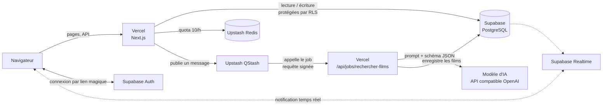
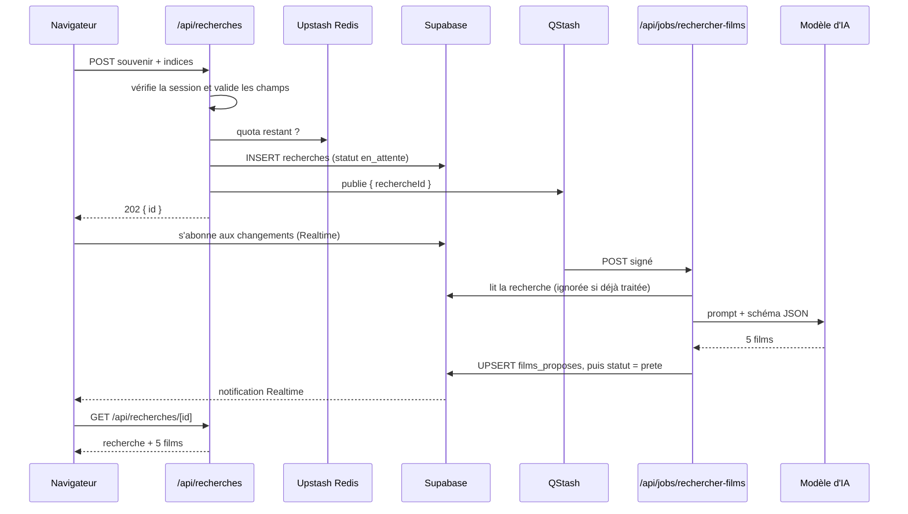
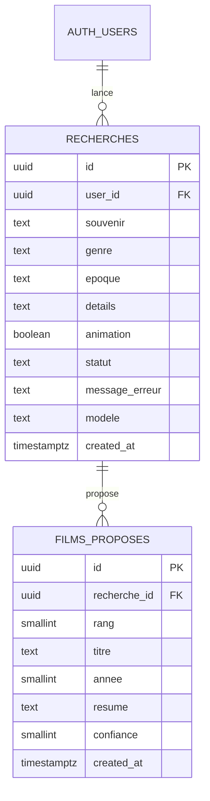

# CinéSouvenir

**Retrouver un film à partir de ses souvenirs, grâce à l'IA.**

On se souvient souvent d'une scène, d'un personnage ou d'une ambiance, mais plus du titre. Sur CinéSouvenir, l'utilisateur décrit ce dont il se souvient, ajoute quelques indices facultatifs, et un modèle d'IA lui propose les **5 films qui correspondent le mieux**, chacun avec un résumé et un score de confiance.

L'application est construite avec Next.js et repose sur plusieurs services cloud : Vercel pour l'hébergement, Supabase pour l'authentification, la base de données et le temps réel, Upstash pour la file de messages et la limitation de débit, et un modèle d'IA accessible par une API compatible OpenAI.

---

## Sommaire

1. [Fonctionnalités](#fonctionnalités)
2. [Architecture](#architecture)
3. [Déroulement d'une recherche](#déroulement-dune-recherche)
4. [Base de données](#base-de-données)
5. [Utilisation de l'IA](#utilisation-de-lia)
6. [Sécurité et robustesse](#sécurité-et-robustesse)
7. [Structure du code](#structure-du-code)
8. [Installation en local](#installation-en-local)
9. [Déploiement sur Vercel](#déploiement-sur-vercel)
10. [Variables d'environnement](#variables-denvironnement)

---

## Fonctionnalités

### Page d'accueil (`/`)
Page publique qui présente le principe du site : accroche, les trois étapes (« Racontez vos souvenirs », « Ajoutez des indices », « Recevez 5 propositions ») et un exemple de résultat.

### Connexion par e-mail, sans mot de passe (`/connexion`)
L'utilisateur saisit son adresse e-mail et reçoit un **lien magique** envoyé par Supabase Auth. En cliquant dessus, il est connecté : `/auth/callback` échange le code du lien contre une session stockée dans des cookies. Toutes les pages, sauf l'accueil, sont réservées aux utilisateurs connectés. Un visiteur non connecté est redirigé vers `/connexion`.

### Recherche d'un film (`/recherche`)
Le formulaire contient :

| Champ | Obligatoire | Détail |
|---|---|---|
| Ce dont vous vous souvenez | oui | 20 à 5 000 caractères, avec compteur en direct |
| Genre | non | liste de 12 genres |
| Époque | non | par décennie, d'« Avant 1960 » aux « Années 2020 » |
| Acteurs ou détails | non | 500 caractères au maximum |
| Film d'animation | non | interrupteur |

Après l'envoi, la page affiche l'avancement (« Envoi de la demande… », puis « Recherche en cours… ») avec des blocs de chargement. Les résultats apparaissent **automatiquement, sans recharger la page**, grâce à Supabase Realtime.

### Résultats
Les 5 films sont classés du plus probable au moins probable. Pour chacun : **titre, année, résumé d'une ou deux phrases (sans révéler la fin) et score de confiance** en pourcentage. La couleur du badge dépend du score : 70 % et plus, entre 40 et 69 %, moins de 40 %.

### Historique (`/recherches` et `/recherches/[id]`)
Chaque recherche est enregistrée. L'utilisateur retrouve la liste de ses recherches, avec le statut « En cours » ou « Échec » si elle n'est pas terminée. Le détail d'une recherche rappelle le souvenir et les indices saisis, puis les films proposés. Si l'utilisateur quitte la page pendant le traitement, ses résultats l'attendent dans l'historique.

### Quota d'utilisation
Chaque utilisateur peut lancer **10 recherches par heure** (fenêtre glissante). Le formulaire affiche le nombre de recherches restantes. Au-delà, l'API répond `429` et indique dans combien de minutes réessayer.

### Tableau de bord administrateur (`/admin`)
Cette page est réservée aux adresses listées dans `ADMIN_EMAILS` : pour tout autre utilisateur, elle renvoie une erreur 404. Elle vérifie en direct l'état de chaque service cloud :

| Service | Vérification |
|---|---|
| Vercel | environnement, région et commit déployé |
| Modèle d'IA | le modèle configuré est disponible chez le fournisseur |
| Supabase Database | nombre de recherches et de films proposés |
| Supabase Auth | le service d'authentification répond |
| Upstash Redis | `PING`, puis nombre de clés |
| Upstash QStash | variables présentes, puis appel à l'API |
| Supabase Realtime | ouverture d'une connexion WebSocket |

Chaque service est marqué **opérationnel**, **dégradé** (réponse en plus de 2 s) ou **en panne** (erreur, ou pas de réponse au bout de 5 s).

---

## Architecture



| Service | Rôle |
|---|---|
| **Vercel** | Héberge l'application Next.js : pages, routes API et job de traitement, exécutés en fonctions serverless |
| **Supabase Auth** | Connexion par lien magique envoyé par e-mail, session dans des cookies |
| **Supabase PostgreSQL** | Stocke les recherches et les films proposés, avec Row Level Security |
| **Supabase Realtime** | Prévient le navigateur dès qu'une recherche change de statut |
| **Upstash Redis** | Limite le nombre de recherches par utilisateur (`@upstash/ratelimit`) |
| **Upstash QStash** | File de messages : déclenche le job en arrière-plan, avec nouvelles tentatives automatiques |
| **Modèle d'IA** | Par défaut `openai/gpt-oss-120b` chez Groq. Tout fournisseur compatible OpenAI convient |

Pourquoi un traitement **asynchrone** ? La réponse de l'IA peut prendre plusieurs secondes. Plutôt que de garder la requête HTTP ouverte, l'API enregistre la demande et rend la main tout de suite (`202 Accepted`). QStash appelle ensuite le job, et le navigateur est prévenu par Realtime. Si l'IA est momentanément indisponible, QStash relance le job sans que l'utilisateur ait à refaire sa demande.

---

## Déroulement d'une recherche



1. **Envoi** : le navigateur envoie le souvenir et les indices à `POST /api/recherches`.
2. **Vérifications** : l'API vérifie la session, valide les champs et consulte le quota dans Redis.
3. **Enregistrement** : la recherche est créée avec le statut `en_attente`, puis un message est publié dans QStash. L'API répond aussitôt `202`.
4. **Attente** : le navigateur s'abonne aux changements de la recherche avec Supabase Realtime, et attend au plus 90 secondes.
5. **Traitement** : QStash appelle le job. Celui-ci vérifie la signature du message, interroge l'IA, enregistre les 5 films, puis passe la recherche au statut `prete`.
6. **Affichage** : notifié par Realtime, le navigateur récupère les résultats et les affiche.

En cas d'erreur passagère (IA saturée, délai dépassé, panne réseau), le job répond `500` et QStash le relance, jusqu'à 3 fois. Si l'erreur est définitive ou si c'était la dernière tentative, la recherche passe au statut `erreur` avec un message lisible.

---

## Base de données

Le script complet se trouve dans [`supabase/schema.sql`](supabase/schema.sql).



- **`recherches`** : une ligne par demande. `user_id` prend automatiquement la valeur de l'utilisateur connecté (`auth.uid()`). `statut` vaut `en_attente`, `prete` ou `erreur`.
- **`films_proposes`** : les 5 films d'une recherche. La contrainte `unique (recherche_id, rang)` empêche les doublons quand le job est relancé.
- **Suppression en cascade** : supprimer un utilisateur supprime ses recherches, et supprimer une recherche supprime ses films.
- **Contraintes `check`** : la base applique les mêmes limites que l'application. Par exemple, la longueur du souvenir, les genres et époques autorisés, et une confiance comprise entre 0 et 100.

**Row Level Security** :

| Table | Utilisateur connecté | Job (clé secrète) |
|---|---|---|
| `recherches` | lit, crée et supprime **ses** recherches. Il ne peut pas modifier le statut | lecture et écriture |
| `films_proposes` | lit uniquement les films de **ses** recherches | lecture et écriture |

---

## Utilisation de l'IA

Le prompt se trouve dans [`src/lib/rechercher-films.ts`](src/lib/rechercher-films.ts).

- **Rôle** : un expert en cinéma qui aide à retrouver un film dont on a oublié le titre.
- **Consignes** :
  - proposer uniquement des films qui existent réellement, sans doublon ni série télévisée ;
  - donner le titre français s'il existe ;
  - tolérer un souvenir imprécis ou en partie faux ;
  - se servir des indices pour départager les films proches ;
  - écrire un résumé sans révéler la fin ;
  - rester honnête sur la confiance quand rien ne correspond vraiment.
- **Sortie structurée** : la requête impose un **schéma JSON strict** (`response_format: json_schema`), qui demande une liste de films `{ titre, annee, resume, confiance }`.
- **Validation côté serveur** : la réponse est vérifiée, la confiance est ramenée entre 0 et 100, puis les films sont triés et limités à 5. Si le format n'est pas respecté, la génération est relancée une fois.
- **Protection contre l'injection de prompt** : le souvenir est placé entre délimiteurs, et le modèle a pour consigne d'ignorer toute instruction qu'il contiendrait.
- **Paramètres** : température 0,3 et délai maximal de 30 s par appel.

---

## Sécurité et robustesse

- **Authentification obligatoire** : le proxy Next.js ([`src/proxy.ts`](src/proxy.ts)) rafraîchit la session à chaque requête et redirige les visiteurs non connectés. Chaque route API vérifie aussi la session.
- **Isolation des données** : grâce à la Row Level Security, un utilisateur ne peut ni voir ni modifier les recherches d'un autre, même en appelant Supabase directement.
- **Clé secrète réservée au serveur** : le client administrateur Supabase n'est utilisé que par le job et par les contrôles de `/admin`. Ces fichiers sont marqués `server-only`, ce qui empêche de les inclure par erreur dans le code envoyé au navigateur.
- **Job protégé** : `/api/jobs/rechercher-films` refuse tout appel qui ne porte pas une signature QStash valide.
- **Idempotence** : une recherche déjà traitée n'est jamais retraitée, et l'upsert évite les doublons de films.
- **Limitation de débit** : 10 recherches par heure et par utilisateur. Si Redis est indisponible, la recherche reste possible et l'incident est journalisé.
- **Validation partout** : les champs sont contrôlés dans le formulaire, dans l'API et dans la base.

---

## Structure du code

```
supabase/
  schema.sql                   Création des tables, des politiques RLS et de Realtime
src/
  proxy.ts                     Rafraîchit la session, redirige si l'utilisateur n'est pas connecté
  app/
    page.tsx                   Page d'accueil (publique)
    connexion/                 Connexion par lien magique
    auth/callback/             Échange du code du lien contre une session
    recherche/                 Formulaire de recherche
    recherches/                Historique et détail d'une recherche
    admin/                     Tableau de bord des services
    api/
      recherches/              POST : créer une recherche · GET [id] : la lire
      jobs/rechercher-films/   Job appelé par QStash : appel à l'IA et enregistrement
      admin/statut/            Contrôle des services cloud
  components/
    FormulaireRecherche.tsx    Formulaire, attente Realtime, affichage des résultats
    ListeFilms.tsx             Liste des 5 films
    EnTete.tsx, ...            En-tête, connexion, déconnexion, tableau de statut
    ui/                        Composants shadcn/ui (Base UI + Tailwind CSS)
  lib/
    recherche.ts               Types, genres, époques, limites, validation (client et serveur)
    recherche-serveur.ts       Lecture des recherches dans Supabase
    rechercher-films.ts        Prompt, schéma JSON et validation de la réponse de l'IA
    ia.ts                      Appel générique à l'API compatible OpenAI
    qstash.ts                  Publication des messages
    limitation.ts              Quota avec Upstash Redis
    controles.ts, statut.ts    Contrôles des services pour /admin
    supabase/                  Clients Supabase (navigateur, serveur, administrateur, proxy)
```

**Technologies** : Next.js 16 (App Router, Cache Components), React 19, TypeScript, Tailwind CSS 4, shadcn/ui (Base UI), lucide-react, `@supabase/ssr`, `@upstash/redis`, `@upstash/ratelimit`, `@upstash/qstash`.

---

## Installation en local

Prérequis : Node.js 20 ou plus récent, un projet Supabase, une base Upstash Redis et une clé d'API pour le modèle d'IA (par exemple chez Groq).

1. **Installer les dépendances**
   ```bash
   npm install
   ```
2. **Créer la base de données** : dans Supabase, ouvrez **SQL Editor → New query**, collez [`supabase/schema.sql`](supabase/schema.sql), puis cliquez sur **Run**.
3. **Configurer l'authentification** : dans Supabase, ouvrez **Authentication → URL Configuration**. Mettez **Site URL** à `http://localhost:3000` et ajoutez `http://localhost:3000/auth/callback` dans **Redirect URLs**.
4. **Configurer les variables** : copiez `.env.example` en `.env.local` et remplissez-le (voir [Variables d'environnement](#variables-denvironnement)). En local, QStash utilise son serveur de développement, dont les identifiants s'affichent au démarrage :
   ```
   QSTASH_URL=http://127.0.0.1:8080
   APP_URL=http://localhost:3000
   ```
5. **Lancer les deux serveurs**, dans deux terminaux :
   ```bash
   npm run qstash   # serveur QStash local
   npm run dev      # application sur http://localhost:3000
   ```

---

## Déploiement sur Vercel

1. Importez le dépôt dans Vercel.
2. Dans **Settings → Environment Variables**, ajoutez toutes les variables :
   - **QStash** : les vraies clés, à prendre sur [console.upstash.com/qstash](https://console.upstash.com/qstash) ;
   - **`APP_URL`** : l'URL de production, par exemple `https://cinesouvenir.vercel.app` ;
   - **Redis** : vous pouvez aussi passer par l'intégration Upstash du Marketplace de Vercel. Elle fournit `KV_REST_API_URL` et `KV_REST_API_TOKEN`, que l'application accepte également.
3. Dans Supabase, ajoutez `https://<votre-domaine>/auth/callback` aux **Redirect URLs**.
4. Si la Deployment Protection de Vercel est activée sur l'URL indiquée dans `APP_URL`, QStash ne peut pas appeler le job. Utilisez le domaine de production.
5. Pour vérifier le déploiement, connectez-vous avec une adresse listée dans `ADMIN_EMAILS` et ouvrez `/admin`.

---

## Variables d'environnement

| Variable | Rôle |
|---|---|
| `AI_BASE_URL` | URL de l'API compatible OpenAI (par ex. `https://api.groq.com/openai/v1`) |
| `AI_API_KEY` | Clé d'API du fournisseur d'IA |
| `AI_MODEL` | Modèle utilisé (par ex. `openai/gpt-oss-120b`) |
| `NEXT_PUBLIC_SUPABASE_URL` | URL du projet Supabase |
| `NEXT_PUBLIC_SUPABASE_PUBLISHABLE_KEY` | Clé publique Supabase (utilisée par le navigateur) |
| `SUPABASE_SECRET_KEY` | Clé secrète Supabase, utilisée **uniquement côté serveur** |
| `UPSTASH_REDIS_REST_URL`, `UPSTASH_REDIS_REST_TOKEN` | Base Upstash Redis (ou `KV_REST_API_URL`, `KV_REST_API_TOKEN`) |
| `QSTASH_URL`, `QSTASH_TOKEN` | Accès à QStash |
| `QSTASH_CURRENT_SIGNING_KEY`, `QSTASH_NEXT_SIGNING_KEY` | Vérification de la signature des messages reçus par le job |
| `APP_URL` | Adresse publique de l'application, à laquelle QStash livre les messages |
| `ADMIN_EMAILS` | Adresses autorisées à ouvrir `/admin`, séparées par des virgules |
